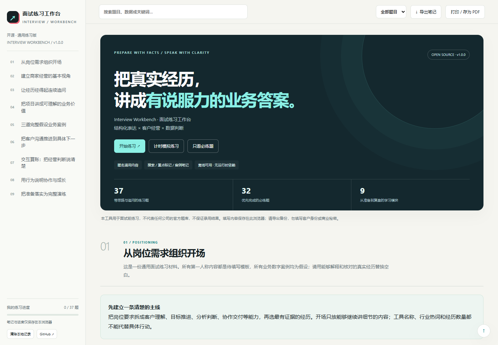
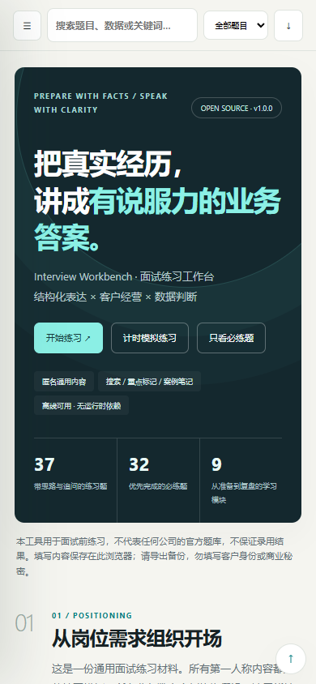

# Interview Workbench

[](https://github.com/LeiQingliang/interview-workbench/actions/workflows/ci.yml)
[](LICENSE)

面向求职者的开源面试练习工作台：用通用问题梳理回答、核对事实，并在浏览器中记录练习笔记。项目内容用于自主准备，不是任何公司的官方题库，也不承诺面试结果。

**[在线演示](https://LeiQingliang.github.io/interview-workbench/)** · [使用与隐私](docs/privacy.md) · [参与贡献](CONTRIBUTING.md) · [内容编写指南](docs/content-guide.md)

## 可以做什么

- 按主题阅读通用面试问题，展开回答框架与追问。
- 用可填写的练习区域整理自己的经历、证据和复盘。
- 搜索题目、标记重点与练习进度，进行计时随机问答。
- 调整商家经营模型的假设参数，观察核销、成本与活动贡献。
- 在当前浏览器中保存笔记，离线继续阅读和练习。
- 导出 Markdown 练习笔记，或打印完整手册；可单独清除本工具记录。
- 通过内容文件维护练习材料，构建为无需服务器运行的单文件页面。

示范回答和虚构情景应作为练习参考，使用前请根据真实经历调整。不要把假设数字或示范故事写进个人履历。

## 界面预览

### 桌面



### 移动端



## 本地运行

需要 **Node.js 22 或更新版本**，以及随 Node.js 提供的 npm。应用没有运行时第三方依赖；开发和端到端测试工具通过锁文件安装。

```sh
git clone https://github.com/LeiQingliang/interview-workbench.git
cd interview-workbench
npm ci
npm run dev
```

在浏览器打开 [http://127.0.0.1:4173](http://127.0.0.1:4173)。开发服务用于本机预览，不是生产服务器。

## 检查、测试与构建

```sh
npm run check
npm test
npm run build
npm run test:e2e
```

端到端测试使用 Playwright。首次运行前，如尚未安装所需浏览器，可执行：

```sh
npx playwright install chromium
```

构建输出：

| 文件                            | 用途                       |
| ------------------------------- | -------------------------- |
| `dist/index.html`               | 静态站点入口               |
| `dist/interview-workbench.html` | 可保存到本机的单文件离线版 |

离线版包含页面所需的内容、样式和脚本，无需 CDN。外部参考链接仍需要联网。通过本地文件打开时，笔记持久化行为取决于浏览器对 `file:` 页面存储的支持；需要稳定保存时，优先使用本机开发服务或站点同一地址。

## 修改练习内容

练习材料位于 `content/guide.json`。页面结构、样式和交互分别位于 `src/template.html`、`src/styles.css` 和 `src/app.js`；通用逻辑位于 `src/lib/`。

修改内容后运行检查与构建，再查看实际页面。HTML内容字段只接受经过审查的项目作者内容，不能用来接收任意用户上传的HTML。详细约定见 [内容编写指南](docs/content-guide.md)。

## 笔记与隐私

笔记只保存在当前浏览器的本地存储中，不加密，不跨设备同步。清除网站数据、更换浏览器或使用无痕模式，都可能导致笔记丢失。同源JavaScript及拥有相关权限的浏览器扩展可能读取笔记。

应用代码不集成分析遥测，不将笔记提交到应用服务器。这不代表访问网站没有网络记录：GitHub Pages等部署平台可能记录请求信息；打开外部链接也适用目标站点的规则。请阅读 [隐私与数据边界](docs/privacy.md)，避免填写身份证件、账号密码、完整客户资料或公司保密信息。

## 部署

项目可以部署到支持静态HTML的托管平台。执行 `npm run build` 后发布 `dist/` 的内容，保留 `index.html` 作为入口。GitHub Pages的具体发布方式取决于仓库设置和部署流程。

使用本仓库的自动部署时，在 **Settings → Pages → Build and deployment → Source** 选择 **GitHub Actions**。推送 `main` 后，CI 会在 Node.js 22/24 上运行检查与单元测试，并在 Node.js 24 上执行桌面、手机和离线浏览器测试。全部通过后才发布同次运行的构建产物。Pull Request 仅运行验证，不部署。

所有第三方 Actions 均固定到完整提交 SHA，依赖由锁文件和 Dependabot 维护。可下载 [单文件离线版](https://LeiQingliang.github.io/interview-workbench/interview-workbench.html)；浏览器直接打开该链接时可能预览页面，请使用“另存为”保存到本机。

发布前请完成检查、单元测试、端到端测试，以及桌面和移动端检查；确认内容、页面源码和示例中没有真实个人资料。部署成功与否应以托管平台的运行结果和实际页面访问为准。

## 项目文档

- [架构与构建流程](docs/architecture.md)
- [隐私与数据边界](docs/privacy.md)
- [内容编写指南](docs/content-guide.md)
- [贡献指南](CONTRIBUTING.md)
- [安全问题报告](SECURITY.md)
- [社区行为约定](CODE_OF_CONDUCT.md)
- [变更记录](CHANGELOG.md)

## 后续方向

以下是讨论方向，不代表已实现功能或交付承诺：

- 扩展不同岗位的通用练习内容。
- 持续改进键盘操作、可读性与移动端体验。
- 完善内容审核与自动化检查。
- 根据社区需求评估多语言支持。

## License

原创代码、文档与原创练习内容采用 [MIT License](LICENSE)。第三方材料保留各自的权利与许可；引用必须标注来源，不因存放在本仓库而自动改为MIT许可。品牌名称仅用于必要说明，不表示合作或认可。

## English

Interview Workbench is a static, open-source workspace for interview preparation. It provides general practice questions, answer frameworks, and browser-local notes. It is not an official question bank and does not guarantee interview outcomes.

Use Node.js 22 or later, run `npm ci`, then `npm run dev`. Build with `npm run build` to produce a static entry page and a self-contained offline HTML file. Notes stay in browser storage, are not encrypted, and are not synced. Hosting providers may still keep access logs. Original code, documentation, and content are MIT licensed; third-party sources retain their own terms.
