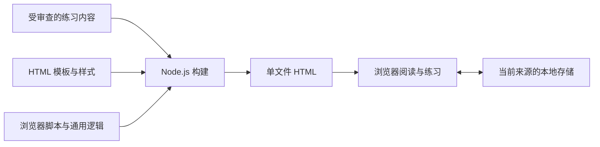

# 架构与构建流程

Interview Workbench采用静态内容与浏览器交互结合的方式。开发环境需要Node.js 22或更新版本；浏览器端没有运行时第三方依赖，也没有应用后端。

## 目录职责

| 路径                            | 职责                                 |
| ------------------------------- | ------------------------------------ |
| `content/guide.json`            | 通用练习内容及内容结构               |
| `src/template.html`             | 页面结构与构建入口模板               |
| `src/styles.css`                | 视觉布局、响应式与交互状态样式       |
| `src/app.js`                    | 页面交互与浏览器端初始化             |
| `src/lib/*.js`                  | 可复用的逻辑与辅助函数               |
| `scripts/build.mjs`             | 组装内容、样式和脚本，生成单文件输出 |
| `scripts/serve.mjs`             | 本机预览服务                         |
| `dist/index.html`               | 静态托管入口                         |
| `dist/interview-workbench.html` | 离线使用的单文件页面                 |

开发工具和测试依赖由npm锁文件管理。零运行时依赖并不表示开发环境不需要安装任何包。

## 数据流



构建阶段将练习内容与静态资源组装为完整页面。运行时由浏览器处理阅读、交互和笔记保存；笔记不参与构建，也不回写内容源文件。

## 常用命令

```sh
npm ci
npm run check
npm test
npm run test:e2e
npm run build
npm run dev
```

`npm test` 使用Node.js内置测试机制；端到端测试使用Playwright。`npm run dev` 在 `127.0.0.1:4173` 提供本机预览。不要直接把开发服务器当作公开部署服务。

## 内容与信任边界

内容中的HTML属于受信任的作者输入，而不是任意上传数据。项目依赖贡献评审与检查来保证内容质量，不能把构建成功理解为HTML已被安全净化。

若将来增加外部内容导入，应先重新设计输入验证、渲染方式、URL策略及存储边界，并补充针对性测试。不能简单把外部字符串插入现有HTML字段。

## 本地状态

用户笔记属于浏览器本地状态。应使用稳定的内容和笔记标识，避免文本调整导致关联失效。修改存储键或数据结构前，需要明确旧数据兼容、迁移或失效行为，并更新隐私说明。

本地状态不会跨来源自动共享：站点地址、本机开发服务和离线文件是不同的使用环境；不同浏览器与设备也不会自动同步。浏览器可能限制或拒绝存储，界面应如实表达保存失败，而不是暗示已经可靠持久化。

## 单文件与部署

两个构建输出都应包含运行页面所需的资源，不依赖CDN。静态部署发布 `dist/` 即可；离线副本可直接保存到本机。外部参考链接、托管平台记录和浏览器环境不属于“单文件离线”能够消除的边界。

发布前应验证构建结果、交互、键盘使用和移动端表现。截图是文档材料，应使用通用内容，不应展示贡献者的真实笔记。
